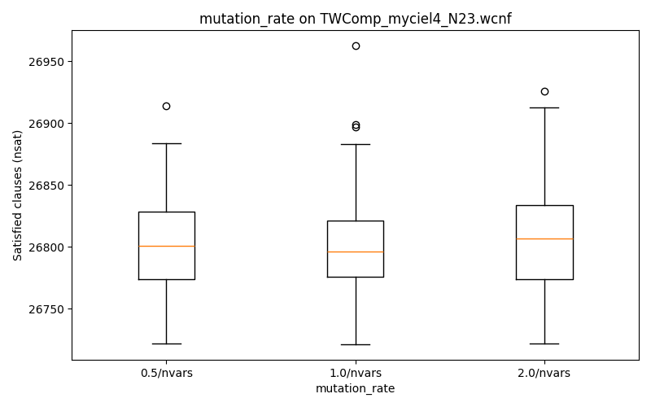
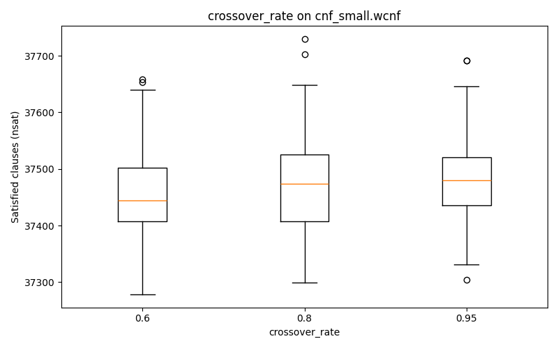

# MAXSAT with an Evolutionary Algorithm

Given a Boolean formula in CNF, MAXSAT asks for the truth assignment that satisfies as many clauses as possible. It's NP-hard, so instead of an exact solver this project uses a time-limited **genetic algorithm** and then looks at which of its parameters actually matter.

Built for Lab 2 of the Evolutionary Computation module at the University of Birmingham (2025). The solver is a single dependency-free Python file and runs inside the module's Docker marking image.

## How the algorithm works

- **Representation:** a bitstring of length *n*, bit *i* = truth value of variable *x<sub>i</sub>*
- **Fitness:** number of satisfied clauses
- **Initialisation:** uniformly random population
- **Selection:** tournament, size 3
- **Crossover:** one-point, probability 0.9
- **Mutation:** independent bit-flip, rate 1/*n* (about one flip per child)
- **Elitism:** the best assignment found so far is always copied into the next generation
- **Stopping:** wall-clock time budget

Full pseudocode is in the [report](report/maxsat-report.pdf) (Exercise 4).

## Usage

No dependencies are needed for the solver itself (Python 3.8+).

**1. Check a single clause.** A clause is written as `weight lit lit ... 0`, and the weight is ignored:

```bash
$ python maxsat.py -question 1 -clause "0.5 2 1 -3 -4 0" -assignment 0000
1
$ python maxsat.py -question 1 -clause "0.5 2 1 -3 -4 0" -assignment 0011
0
```

**2. Count satisfied clauses in a WDIMACS file:**

```bash
$ python maxsat.py -question 2 -wdimacs examples/example.wcnf -assignment 0001
2
```

**3. Run the EA.** It prints one line per repetition: `runtime  nsat  best_assignment`, where runtime = generations × population size.

```bash
$ python maxsat.py -question 3 -wdimacs examples/random3sat_200.wcnf -time_budget 1 -repetitions 3
9100    834    1101111111101011001100010100001010111...
8000    834    1110110110101000001011100001111000011...
7400    837    1001001111100111010000010100001101011...
```

Optional tuning flags: `-pop_size` (default 100), `-cross_rate` (0.9), `-mut_rate` (1/n).

### Docker

```bash
docker build . -t maxsat-ea
docker run --platform=linux/amd64 maxsat-ea
```

The base image `pklehre/ec2025-lab2` comes from the module and runs its own test cases against the solver.

## Parameter study

I varied one parameter at a time around the baseline (pop 100, mutation 1/*n*, crossover 0.9), using 100 repetitions per setting and a 0.2s budget per run, on three [MaxSAT Evaluation 2017](https://maxsat-evaluations.github.io/2017/) unweighted instances: `TWComp_myciel4_N23`, `scpclr13_maxsat` and `cnf_small`.

| Parameter | Values tried |
|-----------|--------------|
| Population size | 50, 100, 200 |
| Mutation rate | 0.5/n, 1/n, 2/n |
| Crossover rate | 0.6, 0.8, 0.95 |

<p align="center">
  
  
</p>

What came out of it:

- **Mutation rate mattered most.** Too low and the search gets stuck; too high and good partial assignments get wrecked. 1/*n* was the best balance overall, although how much it mattered varied by instance.
- **Population size is a trade-off under a time budget.** Bigger populations add diversity but mean fewer generations in the same 0.2s, so the median barely moved. Larger populations were a bit more stable.
- **Crossover rate had the smallest effect.** All three values performed similarly, so selection and mutation seem to be doing most of the work here.

All nine boxplots are in [`docs/figures/`](docs/figures) and the discussion is in the report (Exercise 5).

### Reproducing it

```bash
pip install -r requirements.txt

# with the MSE17 instances (download separately)
python experiments/parameter_study.py path/to/*.wcnf --reps 100 --budget 0.2

# or quickly on a generated random 3-SAT instance
python experiments/generate_instance.py 200 852 -o examples/random3sat_200.wcnf
python experiments/parameter_study.py examples/random3sat_200.wcnf --reps 20
```

This writes `results/results.csv` and one boxplot per parameter and instance.

## Tests

```bash
python -m pytest
```

They cover the clause checker and file loader against the examples from the spec, the genetic operators, and the exact output format of each `-question` mode.

## Layout

```
maxsat.py                      the solver (all three exercises)
Dockerfile                     submission image
examples/                      spec example + a generated random 3-SAT instance
experiments/
  parameter_study.py           sweep + boxplots
  generate_instance.py         random k-SAT generator
docs/figures/                  boxplots from the report
report/maxsat-report.pdf       pseudocode and parameter analysis
tests/
```

## Things I'd try next

- Incremental fitness evaluation: only re-check clauses that contain flipped variables, rather than every clause after every mutation.
- A local search step (WalkSAT/GSAT style) on the elite, which is known to help a lot on MAXSAT.
- Store bitstrings as NumPy arrays or Python ints instead of `str`, to get more generations per second.
